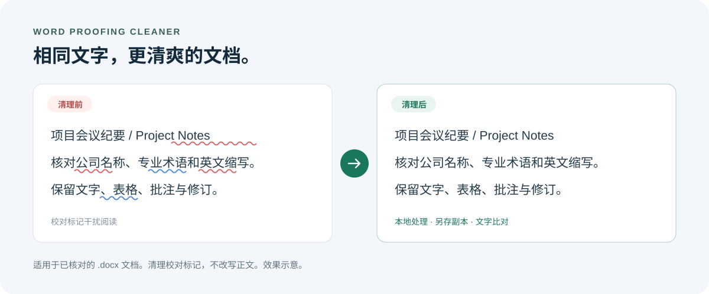

<div align="center">

# Word Proofing Cleaner

### 让 Word 的红蓝波浪线安静下来，保留你已经确认的文字。

清理 `.docx` 的拼写、语法校对标记。适合中文报告、会议纪要、中英混排和专业术语密集的文档。

[快速开始](#三步开始使用) · [作为 Skill 使用](#让-ai-助手帮你处理) · [处理范围](#它会处理什么) · [English](#english)


</div>



*上图为效果示意，不是 Word 实测截图。相同的文字，减少校对标记干扰。*

## 这些问题，你可能遇到过

- 报告里的公司名、行业术语和英文缩写，被 Word 一整片标红。
- 会议纪要内容已经核对，打开文件却仍然满是红蓝波浪线。
- 文档来自不同电脑或模板，清掉旧标记后又被重新检查。
- 想交付一份干净的可编辑文件，同时保留原稿和既有正文。

**把文档交给脚本，得到一个新的 `.docx` 副本，并检查文字是否一致。**

处理过程在本机完成，脚本不上传文档、不调用 AI 模型或云端 API。安装依赖时需要下载 Python 包。

## 为什么使用它

| 你关心的事情 | 本项目的做法 |
| --- | --- |
| 正文会不会被改写？ | 不改写文字；可用 `--verify-text` 比对处理前后的文字内容。 |
| 原文件会不会被覆盖？ | 默认另存新文件；覆盖原稿必须显式使用 `--in-place`。 |
| 校对标记会不会立即回来？ | 清理旧标记，并为现有文字设置跳过校对、更新现有文档的校对显示设置。 |
| 需要 Word 或付费接口吗？ | 运行脚本无需安装 Word，也无需 API Key；需要 Python 和 `lxml`。 |
| 可以继续编辑吗？ | 输出仍是 `.docx`，保留文档结构，不转成图片或 PDF。 |
| 批注和修订怎么办？ | 不接受或拒绝修订，不删除批注；原有审阅内容保留。 |

**处理后的现有文字会跳过拼写、语法校对，真实的拼写或语法错误仍然存在。请在内容已核对、希望减少标记干扰时使用。**

## 三步开始使用

适用于 Windows、macOS、Linux，要求 **Python 3.10+**。以下命令在本地终端执行。

### 1. 下载项目

```bash
git clone https://github.com/czd176224-rgb/word-proofing-cleaner.git
cd word-proofing-cleaner
```

也可以通过本页面的 **Code → Download ZIP** 下载并解压。

### 2. 安装依赖

```bash
python -m pip install -r requirements.txt
```

如果系统使用 `python3` 命令，请相应替换下列命令中的 `python`。

### 3. 生成干净副本

```bash
python scripts/clean_word_proofing.py "input.docx" "output-clean.docx" --verify-text
```

示例：

```bash
python scripts/clean_word_proofing.py "会议纪要.docx" "会议纪要_校对线清理版.docx" --verify-text
```

文字比对通过后会显示：

```text
visible_text_equal: True
output: .../会议纪要_校对线清理版.docx
```

省略输出路径时，会在原文件旁生成 `原文件名_no-proofing-lines.docx`：

```bash
python scripts/clean_word_proofing.py "input.docx" --verify-text
```

只有明确希望覆盖原文件时，才使用：

```bash
python scripts/clean_word_proofing.py "input.docx" --in-place --verify-text
```

比对在写入最终文件前执行；比对失败时，原文件和既有目标文件不会被替换。请先关闭 Word 中占用的目标文件。

## 让 AI 助手帮你处理

仓库同时提供 `SKILL.md` 和 `agents/openai.yaml`，可作为支持本地 Skills 的助手技能使用。把整个项目文件夹放入助手实际使用的技能目录，并按上文安装依赖。

Codex 常用目录示例：

- Windows：`%USERPROFILE%\.agents\skills\word-proofing-cleaner`
- macOS / Linux：`~/.agents/skills/word-proofing-cleaner`

如果你配置了其他技能目录，以实际配置为准。已有同名目录时，先检查内容，避免覆盖自己的修改。重新打开会话后，可以这样说：

```text
请使用 $word-proofing-cleaner 清理这份 Word 的红蓝波浪线。
保留正文、格式、批注和修订，另存一个副本，并验证文字没有变化。
```

助手会调用本仓库的本地脚本。若环境支持，可再打开 Word 检查显示效果。

## 它会处理什么

脚本针对 Word OOXML 校对信息做集中修改：

1. 移除已有 `w:proofErr` 标记。
2. 更新现有 `word/settings.xml` 中的拼写、语法隐藏设置和校对状态。
3. 在现有文字运行属性、样式运行属性及已有默认运行属性中设置 `w:noProof`，包括原先没有显式格式属性的文字。
4. 处理正文、表格中的文字、页眉、页脚、脚注、尾注和批注等现有 Word XML 部件。
5. 使用 `--verify-text` 检查这些内容中的文字、制表符和换行记录是否与输入一致。

未修改的图片和其他包内文件原样保留内容。文本比对和 XML 检查不等于像素级排版验证。

## 使用范围与常见问题

**这是修改文档内容的工具吗？**
它清理校对元数据并调整校对设置，不做润色、纠错或内容改写。

**支持哪些文件？**
目前支持可正常解包的 `.docx`。不支持旧版 `.doc`、加密文档、PDF、PowerPoint 或宏文档 `.docm`。

**能清掉修订产生的红字、删除线或手工下划线吗？**
这些属于其他格式或审阅功能，本工具不会主动删除。请先确认看到的是拼写、语法校对波浪线。

**为什么处理后仍可能出现提示？**
Word 版本、编辑器扩展、重新检查操作、后续粘贴或新输入的文字，都可能引入新的检查。脚本针对已有文字和文档设置，不控制每台电脑的 Word 全局选项。可在目标 Word 版本中重新打开确认。

**可以恢复自动校对吗？**
最方便的方式是继续使用保留的原稿。清理会移除旧校对标记并设置跳过校对，本项目当前没有一键恢复命令。

**测试覆盖了什么？**
仓库测试使用程序生成的可丢弃 DOCX，检查旧标记清理、已有“关闭”设置修正、无格式文字、表格与页眉页脚、批注修订、图片保留、重复运行和覆盖保护。它们不替代不同 Word 版本中的界面实测。

2026-10-23 发布前检查：9 项自动测试通过；另用 Windows Microsoft Word 创建并重新打开一个临时 DOCX，确认正文一致、批注和修订开关保留、现有文字已启用跳过校对。该检查不代表所有 Word 版本中的波浪线显示均已实测。

```bash
python -m unittest discover -s tests -v
```

## 反馈与参与

遇到未清掉的标记或兼容性问题，欢迎[提交 Issue](https://github.com/czd176224-rgb/word-proofing-cleaner/issues/new)。请描述文件类型、Word 版本和复现步骤；如需提供样例，请使用去除个人或业务信息的最小文档。

如果它帮你少处理了一次满屏波浪线，欢迎点一个 **Star**，也欢迎提交改进。

---

## English

**Clear distracting Word proofing marks while keeping your text.**

Word Proofing Cleaner is a local Python utility and reusable agent Skill for `.docx` files. It is useful for reviewed reports, meeting minutes, bilingual documents, company names and technical terminology that trigger excessive spellcheck or grammar marks.

- Creates a separate output by default; overwriting requires `--in-place`.
- Removes stale proofing markers, updates existing document proofing settings and marks existing runs as `noProof`.
- Offers `--verify-text`, checked before the final output replaces any existing file.
- Preserves comments, tracked changes and media; it does not rewrite or correct text.
- No document uploads, model calls, API keys or Microsoft Word installation are needed to run the script.

```bash
python -m pip install -r requirements.txt
python scripts/clean_word_proofing.py "input.docx" "output-clean.docx" --verify-text
```

Requires Python 3.10+ and `lxml`. The current version supports `.docx` only. Suppressing proofing does not fix spelling or grammar mistakes. New edits, editor extensions or explicitly rechecking a document may introduce new marks. Structural tests are included; rendering and UI behavior vary by Word version.

Licensed under the [MIT License](LICENSE).
